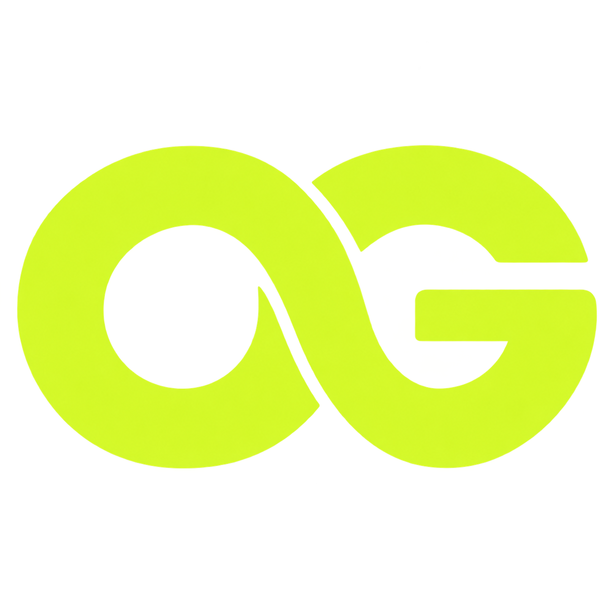

<p align="center">
  
</p>
<h1 align="center">Open Genjutsu</h1>
<p align="center"><strong>Keep the motion. Change the character.</strong><br>A local, open-source video studio with your original soundtrack intact.</p>
<p align="center">
  <a href="https://github.com/abdullayevziyodulla/open-genjutsu/actions/workflows/tests.yml"></a>
  <a href="LICENSE"></a>
  
</p>
<p align="center">
  <a href="https://github.com/abdullayevziyodulla/open-genjutsu/releases/latest"><strong>Download</strong></a> ·
  <a href="#quick-start">Quick start</a> ·
  <a href="docs/MODELS.md">Providers</a> ·
  <a href="https://github.com/abdullayevziyodulla/open-genjutsu/issues">Feedback</a>
</p>


### Your video. Your references. Your workspace.

| Motion guidance | Character picker | Original audio |
| :--- | :--- | :--- |
| Prepare colored depth and subject masks, then review the whole clip. | Upload, replace, remove, or reuse references saved in local jobs. | Export with the complete source soundtrack restored. |

Choose a supported model from a searchable picker. Review the exact request and available price estimate before generating. Follow progress and return to saved results in History.

**The app is free and MIT licensed. Hosted preparation and generation use your own paid provider accounts.**

## Quick start

Download the [latest source ZIP](https://github.com/abdullayevziyodulla/open-genjutsu/releases/latest) and extract it, or clone:

```bash
git clone https://github.com/abdullayevziyodulla/open-genjutsu.git
cd open-genjutsu
```

Install **Python 3.12+** and **Rubber Band CLI**. On Windows, put `rubberband.exe` on PATH or in `tools/rubberband`. On macOS use `brew install rubberband`; on Ubuntu use `sudo apt install rubberband-cli python3-venv`.

<details open>
<summary><strong>Windows</strong></summary>

```powershell
python -m venv .venv
.venv\Scripts\python.exe -m pip install -r requirements.txt
.venv\Scripts\python.exe start-windows.py
```

After installation, you can double-click **Start-Open-Genjutsu.cmd**. Use **Stop-Open-Genjutsu.cmd** to stop the studio.

</details>

<details>
<summary><strong>macOS / Linux</strong></summary>

```bash
python3 -m venv .venv
.venv/bin/python -m pip install -r requirements.txt
.venv/bin/python launch.py
```

Use `PORT=8771 .venv/bin/python launch.py` to select another port.

</details>

Open **http://127.0.0.1:8770**. The Windows launcher picks another available port if necessary.

### Connect your accounts

Open **API settings** in the studio, or copy `.env.example` to `.env`.

- **Replicate token:** required for vocal separation, depth and subject masks.
- **Video provider:** choose Oxen, Replicate or Lec and add your own key.
- **Oxen storage:** use an existing **private** `namespace/repository` for generation inputs.

Keys stay in your local `.env`. Selecting files and models does not submit a generation. Inputs go to the selected providers when you explicitly prepare or generate.

## Make your first video

**01 · Add motion** — Select the original video. Prepare its guidance with your Replicate account. Preparation is billed.

**02 · Add identity** — Open the character picker. Upload a portrait or supported identity video, or reuse a local reference. A second slot means a different person, not another angle of the first person. Wan accepts one photo.

**03 · Review & generate** — Watch the entire prepared clip and approve its mask or tracking. Choose your model, review the exact request and price estimate, then generate.

**04 · Keep the soundtrack** — Download the finished video in Results. Supported HD renders require another deliberate action and separate billing.

### Supported paths

| Model / provider | Starting output | Higher resolution |
| :--- | :--- | :--- |
| Seedance 2.5 · Oxen | 480p draft | 1080p render of the saved draft |
| Seedance 2.5 · Replicate | 480p preview | New 720p generation |
| Wan 2.2 Animate · Replicate | 480p preview | New 720p generation |
| Seedance 2.5 · Lec | 720p | No separate HD step |

The quality picker shows what each adapter actually supports. Higher resolution is offered after a draft is ready. Availability, moderation, pricing, and identity or motion fidelity depend on the provider.

<details>
<summary><strong>What happens during preparation?</strong></summary>

Default preparation isolates vocals, pitches them +3 semitones without changing timing, and embeds them in a colored-depth composite with the subject mask. The source remains intact. The final export restores the complete untouched original soundtrack.

Optional local MediaPipe guidance can be installed with `bash setup-face-mesh.sh` using Python 3.12. Mesh modes are experimental and work best with one centered speaker. Wan uses the original video with its own tracking rather than the depth composite.

</details>

## Build with us

Bug reports and contributions are welcome. Start with [CONTRIBUTING.md](CONTRIBUTING.md). Report issues with sanitized errors and reproduction steps; keep keys and private media out of public reports.

```bash
# On Windows, use .venv\Scripts\python.exe instead.
.venv/bin/python -m unittest discover -s tests
.venv/bin/python test_composite.py
.venv/bin/python scripts/package_release.py
```

The offline checks run in GitHub Actions. The release exporter includes source and project artwork; it excludes credentials, saved jobs, private media, environments, models and Git history.

[Setup](docs/SETUP-AGENT.md) · [Workflow](docs/AGENT-OPERATIONS.md) · [Troubleshooting](docs/TROUBLESHOOTING.md) · [Security](SECURITY.md)

This is a **localhost, single-user studio**. Public multi-user hosting needs authentication, isolated storage and a durable worker queue.

---

<p align="center"><strong>Open source. Bring your own keys. Make it yours.</strong></p>

[MIT license](LICENSE) · [Required attribution](NOTICE) · [Third-party terms](THIRD-PARTY.md). Independent project; no affiliation with a commercial video platform. No model weights or third-party demonstration footage are bundled.

### Interface language

Open **Settings → Language** to choose **English** or **O‘zbekcha**. English is the default. The choice is saved in your browser and also applies to the setup guide. Prompts, API keys, filenames, and provider responses stay unchanged.
