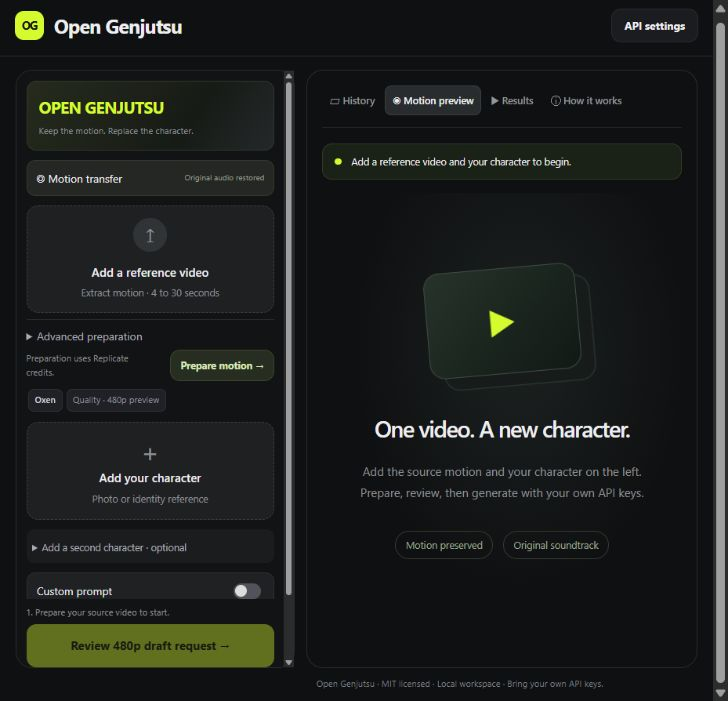

# Open Genjutsu

**An open-source studio for changing video characters while keeping the scene, motion and original soundtrack.**

Run it locally, bring your own API keys, and review each request before generating. No subscription to this project, proprietary companion app, affiliate links or bundled account is required. Hosted model inference is paid separately to your chosen providers.



## Start here

Download the [latest source release](https://github.com/abdullayevziyodulla/open-genjutsu/releases/latest), extract it, and follow the steps below. You can also clone this repository.

1. Install Python 3.12+ and the Rubber Band CLI. On Windows, put `rubberband.exe` on PATH or in the project's `tools/rubberband` folder. On macOS: `brew install rubberband`. On Ubuntu: `sudo apt install rubberband-cli python3-venv`.
2. Install the app:

```bash
python -m venv .venv
# Windows
.venv\Scripts\python.exe -m pip install -r requirements.txt
# macOS / Linux
.venv/bin/python -m pip install -r requirements.txt
```

3. Copy `.env.example` to `.env`, or use **API settings** in the studio. Configure Replicate for preparation and your selected video provider. For Oxen, supply your key and an existing **private** `namespace/repository` for input storage. Keys are stored locally and never displayed back.
4. Start the studio:

```bash
# Windows: double-click Start-Open-Genjutsu.cmd, or:
.venv\Scripts\python.exe start-windows.py
# macOS / Linux:
.venv/bin/python launch.py
```

Open **http://127.0.0.1:8770**. The Windows launcher selects an available port if needed. Use `PORT=8771 .venv/bin/python launch.py` on macOS/Linux to choose another port. Stop the Windows server with `Stop-Open-Genjutsu.cmd`.

## Make a video

1. Upload your original video and prepare its motion guidance. **Preparation can incur Replicate charges.**
2. Add a character photo or supported identity video. The optional second reference represents a **different character**, not another face angle of the first character.
3. Watch the complete prepared preview and approve the mask or face tracking. Preparation defects should be repaired before generation.
4. Describe the replacement, review the exact prompt and available cost estimate, then generate. Costs are estimates; output duration and provider pricing determine final charges.
5. Download the finished video with the complete original soundtrack. Any supported HD render requires a separate deliberate action and is separately billed.

The compact left panel contains your source, character references, optional custom prompt, model settings and generation action. The right panel has Motion preview, History, Results and How it works. The workspace shows queued/processing states, elapsed time, task IDs, failures and saved results. Restarting resumes collection of accepted requests; it never silently submits another paid generation.

## Providers and preparation

| Purpose | Integration |
| --- | --- |
| Video generation | Oxen Seedance 2.5 by default; optional Replicate Seedance/Wan or Lec adapter |
| Preparation | Replicate vocal separation, colored depth and SAM subject masks |
| Optional facial guidance | Local MediaPipe worker, installed separately with `bash setup-face-mesh.sh` using Python 3.12 |
| Final audio | Local restoration of the original source soundtrack |

Default preparation isolates vocals, pitches them +3 semitones without changing timing, and embeds them in the colored-depth composite. The original source and soundtrack remain intact. Experimental mesh modes support one centered speaker best. Wan uses the original video with its own tracking rather than the depth composite.

No model weights, third-party demonstration videos or artwork are shipped in this source package. Provider availability, moderation, model quality and billing are outside this project's control. There is no guarantee of unrestricted generation or exact motion/identity fidelity.

## Development

```bash
# Use .venv\Scripts\python.exe on Windows
.venv/bin/python -m unittest discover -s tests
.venv/bin/python test_composite.py
.venv/bin/python doctor.py --require-keys
```

Read [setup](docs/SETUP-AGENT.md), [workflow operations](docs/AGENT-OPERATIONS.md), [provider details](docs/MODELS.md) and [troubleshooting](docs/TROUBLESHOOTING.md). Contributions and bug reports are welcome; see [CONTRIBUTING.md](CONTRIBUTING.md). For a public release, use `python scripts/package_release.py`; it exports an allowlisted source ZIP and excludes credentials, jobs, private media, environments and Git history.

To put it on GitHub, follow [the publishing guide](docs/PUBLISHING.md) using the clean source ZIP and a fresh repository in your own account.

This is a **local, single-user application**. It binds to localhost. Do not expose it directly to the internet; multi-user hosting requires authentication, isolated storage and a durable worker queue.

## License

Code and documentation are [MIT licensed](LICENSE). Required copyright notices from the original MIT-licensed implementation are retained in LICENSE and [NOTICE](NOTICE). This independent fork has no affiliation with the upstream creator or any commercial video platform. Dependencies, hosted models and external executables retain their own terms; see [THIRD-PARTY.md](THIRD-PARTY.md).
